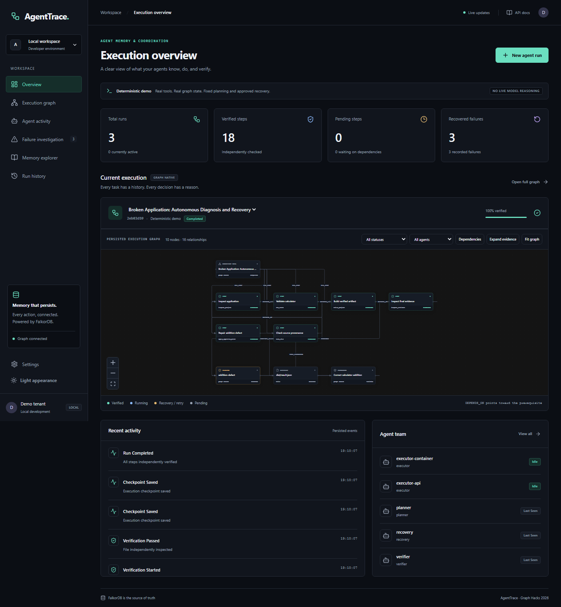

# AgentTrace

**AI Agents That Remember, Recover, and Explain Every Action.**

Graph-native execution memory and coordination for autonomous AI agents. Powered by FalkorDB, with persistent task tracking, failure recovery, multi-agent orchestration, and explainable decisions.

[Source repository](https://github.com/saifmodan2006/agenttrace)

Graph-native execution memory for the WeMakeDevs × FalkorDB Graph Hacks 2026 hackathon. Primary track: **Agent Memory and Coordination**. Secondary track: **Agents That Act on Connected Data**.



Agents need more than logs: they need to know what is already verified, which prerequisites are satisfied, why a task failed, and whether work is safe to retry after a crash. AgentTrace stores those relationships in FalkorDB and uses them to control execution.

## What works

- Validated task DAGs, graph-based readiness and dependency evidence.
- Conditional concurrent claims, per-attempt fencing tokens, renewable leases, stale-result rejection.
- Four cooperating roles: planner, executor, independent verifier, evidence-guided recovery.
- Real isolated broken-application demo: failing tests → recorded Failure → approved repair prerequisite → independent test verification → checked build artifact.
- Persistent attempts, events, facts, procedures, checkpoints, and decision evidence.
- Process kill/restart reconciliation; completed tasks are not blindly repeated.
- Authenticated tenant namespaces, separately authenticated worker endpoints, bounded parameterized queries.
- Dashboard with overview, live graph, run creation, activity, failure investigation, memory explorer, history/resume, and settings; dark/light modes and responsive layout.
- Multi-hop dependency impact and downstream stale-verification flags.

FalkorDB is foundational: DEPENDS_ON determines eligibility, Failure/Procedure paths select recovery, and persisted Attempt/Checkpoint state controls resume. No hidden local task database takes over when FalkorDB is unavailable.

## Architecture and graph

React/TypeScript/Vite dashboard → FastAPI → official FalkorDB Python client → persistent tenant graph. Workers use the same graph service as the API. Files and build artifacts occupy isolated persistent workspaces. UI state is fetched from the API, refreshed from graph-backed SSE, and refreshed after reconnect.

Node labels: `AgentRun`, `Step`, `Attempt`, `Agent`, `Event`, `Failure`, `Procedure`, `Fact`, `Artifact`, `Decision`, `Checkpoint`, `Resource`.

Principal paths:

```text
AgentRun ─HAS_STEP→ Step ─DEPENDS_ON→ prerequisite Step
Step ─HAS_ATTEMPT→ Attempt ─CAUSED_FAILURE→ Failure ─RESOLVED_BY→ Procedure
Step ─HAS_DECISION→ Decision ─BASED_ON→ evidence
AgentRun ─HAS_CHECKPOINT→ Checkpoint
Agent ─HANDED_OFF_TO→ Agent
```

Dependency edges point **from dependent to prerequisite**. Impact queries reverse this traversal:

```cypher
MATCH p=(affected:Step)-[:DEPENDS_ON*1..30]->(failed:Step {id:$id})
RETURN affected,nodes(p) LIMIT 300
```

Readiness checks every dependency's succeeded status **and** passed verification in the same conditional write that claims the task. See [actual query documentation](docs/cypher-queries.md), [full schema](docs/graph-schema.md), and [architecture](docs/architecture.md).

## Quick start: Docker

Requires Docker Desktop with its Linux engine running. Containers include Python and Node; no host model key is required.

```powershell
Copy-Item .env.example .env
docker compose up --build -d
```

Linux: `cp .env.example .env`, then the same Docker command.

- Dashboard: http://localhost:5173
- API / OpenAPI: http://localhost:8000/docs
- Health: http://localhost:8000/api/health

These are local defaults, not public deployment URLs. All ports bind to loopback. FalkorDB uses a pinned, tested image digest; RDB snapshots and synchronous checkpoint saves persist to a named volume. AOF is disabled after a reproduced graph-effect replay crash in this image. Abrupt database/host failure can lose writes after the last completed snapshot; see [durability details](docs/recovery-design.md). `docker compose stop` preserves volumes. `docker compose --profile workers up -d worker` adds an independent worker, useful for demonstrating concurrent claims.

## Native Windows development

Requires Python 3.12+, Node 22+, Docker Desktop. Python 3.12 was used for validation. No `uv` required.

```powershell
Copy-Item .env.example .env
py -3.12 -m venv .venv
.\.venv\Scripts\python.exe -m pip install -r backend/requirements.txt
docker compose up -d falkordb
cd backend
..\.venv\Scripts\python.exe -m uvicorn app.main:app --host 127.0.0.1 --port 8000
```

In another terminal:

```powershell
cd frontend
npm ci
npm run dev
```

Linux equivalents: `python3.12 -m venv .venv`, `.venv/bin/python -m pip install -r backend/requirements.txt`, then `cd backend && ../.venv/bin/python -m uvicorn app.main:app --host 127.0.0.1 --port 8000`. Use the same npm commands.

Do not run native and Compose API/frontend simultaneously on the same ports. `scripts/dev.ps1` prepares dependencies and prints startup commands.

## Configuration

| Variable | Purpose / local default |
|---|---|
| FALKORDB_HOST / FALKORDB_PORT | Native database at 127.0.0.1:6379; Compose overrides host to service name |
| FALKORDB_PASSWORD | Optional local password; configure it before any shared deployment |
| TENANT_TOKENS | Server mapping `tenant:token,other:other-token`; default `demo:local-demo-token` |
| WORKER_TOKEN | Additional credential for internal execution operations |
| LEASE_MS | 15000; renewal while work is active |
| WORKER_POLL_SECONDS | 0.5 |
| EMBEDDED_WORKER | 1; set 0 to run only separate CLI workers |
| LLM_BASE_URL | Optional OpenAI-compatible endpoint including `/v1` |
| LLM_MODEL | Model identifier for optional live planning |
| LLM_API_KEY | Optional endpoint credential; never sent to frontend or stored in graph |

The browser uses the local demo token by default. Enter a different token in Settings. Replace all local sample credentials before exposing services, use TLS, and restrict network access. The supplied setup is for local controlled demos, not internet deployment. Secrets belong in ignored `.env`, never Git.

**Deterministic demonstration** uses a fixed plan and approved recovery but executes real tools and independently checks real output. It is explicitly labeled throughout. **Live planning** accepts structured output from a configured compatible endpoint; it has no authority to run arbitrary shell commands or authorize patches without evidence. A real model endpoint has not been configured or validated in this session.

## Demo

Create a run in the UI and use the bundled scenario. Inspect Validate calculator: first attempt fails, recovery inserts a repair dependency, second attempt passes. Open the recovery decision to highlight stored evidence. Reload to see persistent state. Follow [the full walkthrough](docs/demo-guide.md).

HTTP demonstration: `.\.venv\Scripts\python.exe scripts/demo.py` (requires native Python dependencies and running API).

Process crash demo: from backend, `..\.venv\Scripts\python.exe -m pytest tests/test_restart.py -v -s`. It kills a real worker, starts another, and asserts the completed first task was not repeated.

## Validation

With FalkorDB running:

```powershell
cd backend
..\.venv\Scripts\python.exe -m pytest -q
..\.venv\Scripts\ruff.exe check app tests
cd ../frontend
npm run build
npm run lint
npx playwright install chromium
npm test
```

Browser tests expect the native or Docker API/frontend to be running. The optional database durability test is enabled with `$env:RUN_DOCKER_RESTART_TEST='1'` before pytest and restarts and replaces the **agenttrace-db** container; use it only against the local demo. Test graphs are isolated and cleaned up. See [validation results](docs/validation.md) for exact executed results and limitations.

Query timing: `$env:PYTHONPATH='backend'; .\.venv\Scripts\python.exe scripts/benchmark.py`. Actual local timings and EXPLAIN plans are in [query-timings.json](docs/query-timings.json); this tiny dataset is not a production benchmark.

## Backup, restore, and troubleshooting

Stop backend/worker before making a consistent paired graph/workspace backup. Ask Redis to `SAVE`, stop the database, then archive `agenttrace_data` and the Compose workspace volume using your Docker volume backup tooling. Restore to fresh volumes with matching ownership and the same database image; start the database before the API. This backup procedure is documented guidance, not a verified restore drill.

- Docker pipe missing: start Docker Desktop and its Linux engine.
- Database 503: inspect `docker compose ps` and `docker compose logs falkordb`; scheduling deliberately stops.
- 401: check tenant token in Settings against TENANT_TOKENS.
- 403 internal route: also supply X-Worker-Token; frontend does not have this credential.
- Leased step after crash: wait for expiry, then resume; reconciliation handles supported local operations.
- Port conflict: stop native development servers before starting the corresponding Compose services.
- Preserve history with `docker compose stop`; avoid deleting persistent volumes unless you explicitly intend to discard data.

## Scope and submission status

Recovery supports the single approved calculator defect. Tool isolation is not a container/OS sandbox for hostile arbitrary code. Live model behavior, scale/load testing, general semantic retrieval, automatic stale-result revalidation, and a backup/restore drill remain unverified or outside current scope. Graph exports and traversals are bounded; memory search is transparent filtering/ranking rather than model-generated answers. Not every optional schema field in the original product specification is populated.

The source repository is [saifmodan2006/agenttrace](https://github.com/saifmodan2006/agenttrace). The actual demo video and participant technical review are still required. No public deployment or video URL is invented. See [submission draft](docs/submission.md), [video script](docs/video-script.md), and [AI disclosure](AI_USAGE.md). Screenshots in `docs/screenshots/` are captured from the running application when present.

Built with AI assistance; meaningful participant contribution, verification, and technical understanding must be completed and recorded before submission. MIT licensed.
