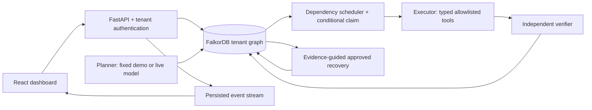

# Architecture

AgentTrace uses FalkorDB as its only task and memory database. Removing it stops planning persistence, claims, scheduling, handoffs, recovery selection, and resume. There is no SQLite, browser task store, or in-memory execution fallback.

## Boundaries

- `backend/app/graph`: official FalkorDB Python client, indexes, constraints, parameterized queries.
- `backend/app/memory`: run state, DAG writes, claims, attempts, events, facts, checkpoints, dependency impact, decisions.
- `backend/app/agents`: four role implementations sharing that manager.
- `backend/app/tools`: fixed subprocess argument vectors and per-tenant/run workspaces.
- `backend/app/workers`: CLI and embedded worker use the same scheduler and executor engine.
- `backend/app/main.py`: tenant-authorized API, separately authenticated worker operations, graph-backed SSE.
- `frontend`: React, TypeScript, Vite, Tailwind, TanStack Query, React Flow, Lucide.

The demo planner is a declared fixed plan, and the recovery agent matches real failure signatures against an approved correction. Optional model mode sends the goal and a strict plan schema to an OpenAI-compatible `/chat/completions` endpoint. Tools and verification stay constrained in both modes. No model key is needed to start the system.

Each tenant token maps to a server-controlled tenant name, then to a SHA-256 graph namespace. The browser cannot choose a graph or tenant ID. The worker API requires both tenant and worker credentials. Public records omit fencing tokens.

## Consistency

A claim checks dependencies, run state, resources, retry budget, delay, and lease in one write command, then creates the attempt, assignment, event, and scheduling decision. FalkorDB serializes graph writes. Result and verification submissions are conditional on current attempt, lease owner, fencing token, status, and unexpired lease. Failed verification creates its Failure in the same state-transition write. Attempt history remains available after recovery.

Pause prevents new claims; an already-running local tool may finish and record its result. Graceful worker shutdown finishes the current action. A hard crash leaves a lease; after expiry, recovery marks it for reconciliation. A successful historical step never becomes ready solely because a process restarted.

Artifacts live in a persistent workspace volume; the graph stores references and checksums. Both volumes must be backed up together.

## Current scope

This is a local hackathon application with cooperating roles, not a general production automation service. The included tool sandbox is an allowlist and filesystem boundary, not an OS security boundary for arbitrary hostile code. Only the bundled controlled application is supported. Live model planning is implemented but needs an endpoint and has not been verified against a real model in this workspace.
